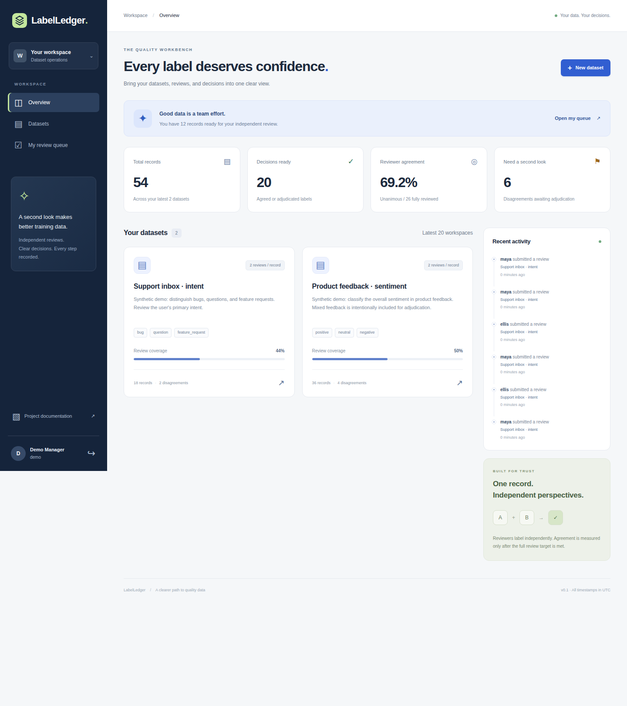

# LabelLedger

**Independent reviews. Measured agreement. Traceable dataset decisions.**

[](https://github.com/Reburn9/sturdy-octo-chainsaw/actions/workflows/ci.yml)


LabelLedger is a Python application for reviewing text datasets before they become training or evaluation data. It imports records, assigns independent reviewers, measures agreement, and routes disputed labels to a manager. Exports contain only agreed or adjudicated decisions.

The project focuses on a concrete problem: a spreadsheet can hold labels, but it does not enforce independent votes, explain agreement denominators, prevent stale overwrites, or preserve the reasoning behind a final decision.



Actual application screenshots from the automated browser run, using clearly marked synthetic data. View the [adjudication screen](docs/images/adjudication.png) and [mobile workspace](docs/images/mobile.png).

## What works today

- Responsive workspace dashboard, dataset explorer, search, state filters, and personal review queues.
- CSV and JSONL imports with full-file validation, duplicate detection, and atomic rollback.
- Per-dataset manager, reviewer, and viewer roles. Unauthorized datasets return 404.
- Assignment limits and one current vote per reviewer per record. Other reviewers' vote values are hidden until a reviewer submits their own.
- Optimistic version checks: stale submissions return 409 instead of silently overwriting work.
- Manager adjudication with a required rationale. Resolved records are locked against further voting.
- Unanimous agreement, pairwise agreement, and Fleiss' kappa with explicit missing-data rules.
- Streaming CSV/JSONL decision exports; CSV formula cells are escaped for spreadsheet safety.
- Application-level append-only audit events committed with workflow changes.
- A session-authenticated JSON API, Django migrations, deterministic synthetic examples, and automated checks.

## Quick start

Requires Python 3.11 or newer and Git. SQLite is included with Python; no database server or JavaScript build tool is needed.

```bash
git clone https://github.com/Reburn9/sturdy-octo-chainsaw.git
cd sturdy-octo-chainsaw
python -m venv .venv
```

Activate the environment:

| Terminal | Command |
|---|---|
| Windows PowerShell | `.venv\Scripts\Activate.ps1` |
| Windows Command Prompt | `.venv\Scripts\activate.bat` |
| macOS / Linux | `source .venv/bin/activate` |

If your system uses `python3`, substitute it for `python` when creating the environment. If PowerShell activation is restricted, use `.venv\Scripts\python.exe` directly in the commands below.

```bash
python -m pip install -r requirements-dev.txt
python manage.py migrate
python manage.py seed_demo
python manage.py runserver
```

Open **http://127.0.0.1:8000**. The seed command prints a freshly generated local password for `demo` (manager), `maya`, and `ellis` (reviewers). It creates 54 synthetic records across two datasets, including agreements, disagreements, adjudications, and unfinished work. It never resets an existing account or invents past activity.

Use `demo` to explore the workspace, then sign in as `maya` or `ellis` to try an independent review. The seed is for local exploration only; it is not sample production access.

### Start with your own dataset

For a clean workspace, skip `seed_demo` and run:

```bash
python manage.py createsuperuser
python manage.py create_reviewer reviewer-one --name "Reviewer One"
python manage.py create_reviewer reviewer-two --name "Reviewer Two"
```

1. Sign in and create a dataset with a fixed label set and 2–5 reviews per record.
2. Import a CSV or JSONL file. A sample CSV can be downloaded from the import screen.
3. Add the reviewer usernames in **Members**, then use **Assign reviews** for each person.
4. Review the assigned records, independently, in each person's **My review queue**.
5. Resolve disagreements as a manager, then export the decided records.

Accounts can also create their own datasets. A dataset role governs access to that dataset; a Django superuser can manage every dataset. There is deliberately no public registration or web-based user administration.

## Data contract

CSV columns are `id,text,metadata`; the metadata column is optional and must contain a JSON object when present. JSONL uses the same fields, one object per line:

```json
{"id":"feedback-001","text":"The dashboard loads quickly, but export still fails.","metadata":{"source":"synthetic-example"}}
```

Each import accepts UTF-8 (including BOM), at most 5 MiB and 10,000 records. IDs are strings of 1–120 characters, text is 1–20,000 characters, and metadata is limited to 20,000 UTF-8 bytes. Unsupported fields and malformed rows fail the entire import. Identical IDs with identical normalized text are skipped; reusing an ID for different text fails the import. Existing metadata is not overwritten by a retry.

Content deduplication hashes NFKC-normalized, whitespace-collapsed text. It is **case-sensitive** and scoped to a dataset. A different ID with the same normalized content is skipped. This is exact normalized matching, not semantic duplicate detection.

## Quality semantics

| State | Meaning | Exported? |
|---|---|---|
| Awaiting review | No votes | No |
| In review | Fewer than the configured number of votes | No |
| Agreed | Review target met; all independent labels match | Yes |
| Needs adjudication | Review target met; independent labels differ | No |
| Resolved | Manager selected a final label and recorded a rationale | Yes |

An assigned reviewer can revise their own vote while a record is unresolved. Every revision increments the record version and adds an audit event. Adjudication preserves the independent votes; it does not rewrite them or inflate agreement. Label sets and review targets cannot be edited after dataset creation, keeping metric comparisons stable.

See [metric definitions](docs/METRICS.md), [architecture and trade-offs](docs/ARCHITECTURE.md), and the [API contract](docs/API.md).

## Run the checks

```bash
ruff check .
ruff format --check .
python manage.py check
python manage.py makemigrations --check --dry-run
coverage run manage.py test ledger.tests
coverage report
```

Tests cover rollback, deduplication, permissions, independent votes, stale versions, adjudication, metric edge cases, CSRF, escaped HTML, export decisions, API contracts, and safe demo creation. CI runs the suite with SQLite on Python 3.11–3.13 and with PostgreSQL on Python 3.12. Coverage has an 85% minimum for the application modules; migrations, tests, and CLI seed helpers are excluded.

Initial implementation verification: **49 tests passed on PostgreSQL**, **48 passed plus one PostgreSQL-only skip on SQLite**, and **98% coverage of the measured application modules**. All six jobs, including the browser workflow and container build, passed in [this recorded CI run](https://github.com/Reburn9/sturdy-octo-chainsaw/actions/runs/43534112672).

The browser smoke script is optional and documented in [development](docs/DEVELOPMENT.md). It exercises actual login, import, reviewer assignment, independent review, adjudication, and export through the interface.

## Structure

| Path | Responsibility |
|---|---|
| `ledger/models.py` | Persistent records and database constraints |
| `ledger/services.py` | Workflow rules, transactions, import validation, metrics |
| `ledger/access.py` | Dataset visibility and role enforcement |
| `ledger/selectors.py` | Search, state filters, and review queue queries |
| `ledger/views.py` | Thin HTML/API adapters around the same services |
| `ledger/exports.py` | Decision selection and safe streaming exports |
| `ledger/templates/`, `ledger/static/` | Server-rendered interface; no external UI services |
| `ledger/tests/` | Behavior and integration tests |
| `docs/` | Architecture, API, operation, and next work |

## Deployment and current limits

Release automation, the PostgreSQL-capable container, and the Render deployment configuration are described in [Publishing and hosting](docs/PUBLISHING.md). The Render configuration uses free initial plans; its free database expires after 30 days. Hosting credentials and the initial operator password remain in private environment settings.

This is a working first release for local or trusted-team use. Debug mode is enabled by default for local development. For deployment, use [the operations guide](docs/OPERATIONS.md): a private secret, explicit hosts, HTTPS, PostgreSQL, backups, login rate limiting, and a real application server. The development server is not the deployment entry point.

Imports are synchronous and bounded per upload. Metrics currently scan a dataset's votes; the dashboard summarizes the latest 20 accessible datasets. Audit events resist edits through application code but are not cryptographically tamper-evident against a database operator. Exports read current decisions, not a versioned dataset snapshot. Local SQLite serializes writes; use PostgreSQL for a busier shared workspace.

## Keep building

The [roadmap](docs/ROADMAP.md) has concrete next steps and acceptance criteria: record-level labeling guidelines, assignment reassignment, SQL-based metric aggregation, frozen export manifests, and background imports. [CONTRIBUTING.md](CONTRIBUTING.md) describes how to make a small change, test it, and explain the trade-off.

This initial implementation was developed with AI assistance. All demo text is synthetic. The repository records actual development; the owner can continue it, test decisions, and adapt it to their own dataset workflow. No AI API key is required to run the application.
