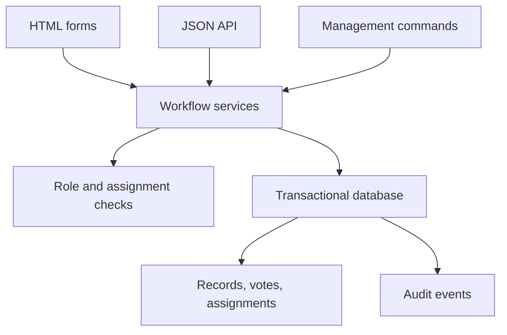
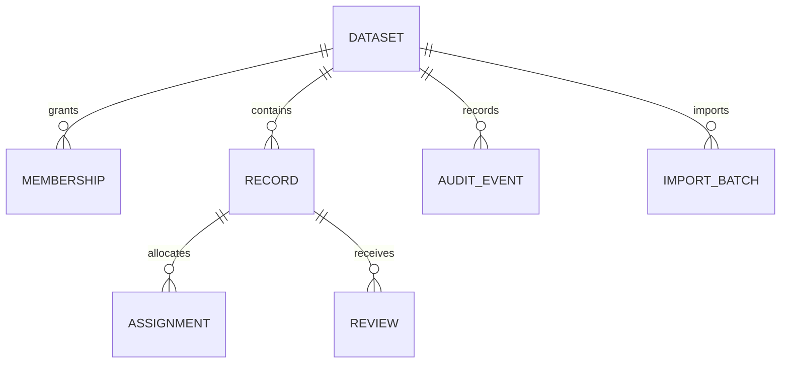

# Architecture and decisions

LabelLedger is a Django monolith: server-rendered HTML and a small JSON API share one service layer. Django supplies sessions, password hashing, CSRF protection, autoescaped templates, ORM queries, and migrations. The frontend uses local CSS and a few lines of progressive-enhancement JavaScript. Forms and navigation work without JavaScript.

## Boundaries

Every user-facing mutation goes through a service. Views own HTTP parsing and rendering; services own state transitions and transactions. A single service transaction contains the record change and its audit event. The export service is read-only apart from a download audit event.

## Persistence

Database uniqueness constraints cover `(dataset, external_id)`, `(dataset, content fingerprint)`, `(dataset, user membership)`, `(record, reviewer assignment)`, and `(record, reviewer vote)`. A check constraint bounds review targets to 2–5. User relationships protect reviewers and managers from accidental deletion while their work exists.

Record state is derived from the independent votes plus an optional adjudication; it is not duplicated in a mutable status column. This avoids stale state when a reviewer revises a label. An adjudicated record stores a final label, manager, and rationale; the underlying votes remain available for quality metrics.

## Concurrent writes

Each record carries a positive integer version. A mutation performs a conditional SQL update matching the expected version and an unresolved record. Exactly one writer can advance that version. A competing or stale form receives 409 and must reload; it does not overwrite the winning decision. Validation failures roll the transaction back, including its tentative version change.

Assignment and import transactions take a dataset write lock to serialize slot allocation and deduplication. SQLite uses `IMMEDIATE` transactions with a 20-second timeout so a writer reserves its lock before reading workflow state. This is intentionally conservative: SQLite serializes all writes. PostgreSQL locks only the touched rows and is the shared-workspace option. No process-local lock is relied on for correctness.

## Choices and costs

| Choice | Why | Cost / next step |
|---|---|---|
| Django monolith | One Python codebase; strong built-in web primitives | Rich client interactions would need incremental JS or an API client |
| SQLite default | Clone and run without infrastructure | Serialized writes; switch to PostgreSQL for heavier use |
| Explicit assignments | Distinct reviewer slots are bounded and inspectable | Abandoned assignments need an audited reassignment flow |
| Fixed label schema | Agreement is comparable across a dataset | Schema changes require a new dataset until versioning is implemented |
| Compare-and-swap version | Same conflict behavior on SQLite and PostgreSQL | Two valid reviewers may need to refresh if they submit concurrently |
| Full-file validation | An invalid last row cannot leave a partial import | Memory/latency bounded by a 5 MiB upload cap |
| Per-record vote privacy | Reviewers label before seeing other vote values | Aggregate metrics can still reveal information in very small datasets |
| Application audit log | Explains work and changes without another service | Database operators can bypass it; no tamper-evidence claim |

## Scope

One installation can host multiple independent datasets. It has no billing, organizations, public registration, external AI inference, or invented analytics history. Current metrics are computed from real stored votes. Synthetic seed data is explicitly marked and timestamped when created.

Framework references: [Django transactions](https://docs.djangoproject.com/en/5.2/topics/db/transactions/), [SQLite transaction behavior](https://docs.djangoproject.com/en/5.2/ref/databases/#transactions-behavior), [authentication](https://docs.djangoproject.com/en/5.2/topics/auth/), and [deployment checks](https://docs.djangoproject.com/en/5.2/howto/deployment/checklist/).
